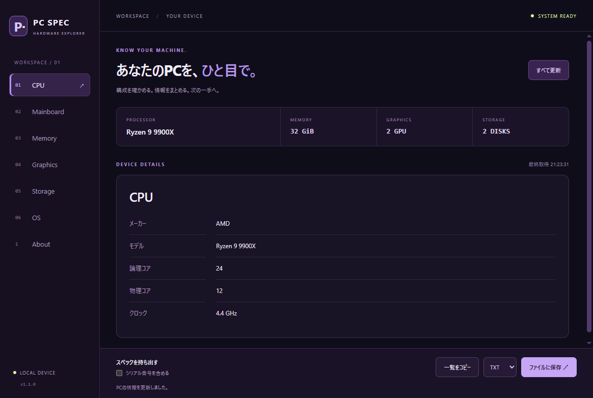

<div align="center">

> 最新バージョン: 1.1.0（2026-11-02）。構成情報の詳細表示、コピー・保存、項目別の再試行と濃い紫の新しいデザインを追加しました。

# PC Spec Tool
**Windows 上で PC の基本情報を確認できるデスクトップアプリ**


</div>

## 概要
**PC Spec Tool** は、Windows 上で PC の基本情報を確認するためのデスクトップアプリです。  
Electron を使用して構成しており、HTML・CSS・JavaScript ベースで動作します。

内部では `systeminformation` を利用して、PC の各種情報を取得・表示します。

## 特徴
- Windows 向けデスクトップアプリ
- HTML・CSS・JavaScript で構成
- `systeminformation` による PC 情報の取得
- インストール版とポータブル版を配布可能
- シンプルな構成で管理しやすい

## 主な機能
- CPU・マザーボード・OS の基本情報表示
- 全GPUのモデル・VRAM・ドライバー情報の表示
- メモリのモジュール別容量・規格・速度・型番の表示
- SSD/HDDの型番・種類・容量と、ボリューム別の使用量・空き容量の表示
- 全項目の更新と、取得に失敗した項目だけの再試行
- スペック一覧のコピー、TXT/JSONへの保存（シリアル番号は既定で除外）
- 濃い紫のサイドバーとカード表示。キーボードでのタブ移動に対応
- Windows 環境でのローカル動作。取得したスペックを外部へ送信する機能はありません



画面はサンプルデータです。機器やドライバーが情報を提供しない項目は「—」になります。
空き容量はボリューム単位で、物理ディスクとの対応付けは行いません。メモリ容量はGiB、ストレージ容量はGB/TBで表示します。

## 動作環境
- Windows 10 / 11
- Node.js 24 系（開発時）
- npm

## 配布ファイル
GitHub の **Releases** では、以下の形式で配布します。

### インストール版
`PC-Spec-Tool-Setup-1.1.0.exe`

NSISインストーラー形式で、通常のインストール、スタートメニュー登録、アンインストールに対応しています。
設定やElectronデータは通常のAppDataへ保存されます。

### ポータブル版
`PC-Spec-Tool-Portable-1.1.0.exe`

`PC-Spec-Tool-Portable-1.1.0.zip`

DLL、resources、localesなどが外に並ばない単体EXEです。

起動すると、EXEと同じ場所に `PC-Spec-Tool-PortableData` が作成され、設定、ログ、キャッシュ、一時ファイルなどが保存されます。

## インストール
### 1. Releases からダウンロード
GitHub の **Releases** から、インストール版またはポータブル版を取得します。

### 2. 利用方法
- インストール版: `PC-Spec-Tool-Setup-1.1.0.exe` を実行してセットアップ
- ポータブル版: ZIPを展開し、`PC-Spec-Tool-Portable-1.1.0.exe` を起動

### コピー・保存と再試行
- 「一覧をコピー」で全項目のテキストをコピーできます。保存形式をTXT/JSONから選び、「ファイルに保存」で保存先を指定します。
- シリアル番号が必要な場合だけ「シリアル番号を含める」をオンにしてください。チェックなしではマザーボード・メモリ・ディスクの番号を出力しません。
- 「すべて更新」で再取得できます。取得失敗時は「この項目を再試行」または「失敗した項目を再試行」を使用します。
- 更新に失敗して前回のデータがある場合は、その旨を画面と出力データに明示します。

## 開発環境での起動方法
### 1. リポジトリを取得
```bash
git clone https://github.com/aki-sho/pc-spec-tool.git
cd pc-spec-tool
```

### 2. 依存関係をインストール
```bash
npm install
```

### 3. 開発版を起動
```bash
npm start
```

### セキュリティ検証
```bash
npm test
npm run test:security
npm audit
npm audit --omit=dev
```

`test:security` は別の一時データフォルダーで実際のElectronを起動し、実機取得、複数機器の表示、コピー・保存、プライバシー設定、取得失敗からの復帰、最小画面サイズ、CSP、画面遷移制限、全IPCの送信元検証を確認します。保存ダイアログとクリップボードはテスト内で置き換え、ユーザーのクリップボードは変更しません。
機器情報とエラーはHTMLとして解釈せず、文字列として表示します。アプリ内から外部ページへの遷移と新規ウィンドウの作成は拒否します。

### 4. Windows向け配布物を作成
```powershell
npm run build:release
```

配布物とSHA256は `dist/1.1.0/` に生成します。ビルド後のapp.asarでも機能・セキュリティ検証を実行し、ZIP構造とコピー後のハッシュを確認します。既存バージョンやPortableDataを削除せず、専用の一時フォルダーで作成します。

### 開発用依存の監査について
2026-11-02の確認では、配布用依存の監査（`npm audit --omit=dev`）は0件です。ビルド用のminimatchとその依存元には[GHSA-g3hv-75wg-m249](https://github.com/advisories/GHSA-g3hv-75wg-m249)によるmoderateの指摘が15件残ります。互換範囲内で更新済みですが、依存元が要求する旧メジャーを含むため解消には依存元の対応が必要です。対象パッケージは配布用app.asarに含めません。
